# Rift Studio

Bộ công cụ phát sóng LoL chạy trên máy Windows. Studio dùng để cấu hình trận,
điều khiển overlay và phát lại bản ghi. OBS nhận hình qua Browser Source.
Bản hiện tại dành cho nội bộ, chưa phải dịch vụ web hoặc bộ cài độc lập.

Overlay có ba cảnh: **cấm chọn**, **trong game** và **sau trận**. Mỗi cảnh là
một trang trong suốt 1920 × 1080, chỉ nhận dữ liệu, nên ghép thẳng lên hình
game hoặc replay trong OBS.

## Xem trước các phần tử

Mọi ảnh/GIF dưới đây là chính overlay đang chạy, cắt đúng vùng của từng phần tử
(nền xanh đen chỉ để dễ nhìn, overlay thật trong suốt). Tệp nằm ở
[docs/media](docs/media). Bảng [nguồn của hình mẫu](#nguồn-của-hình-mẫu) ghi
rõ hình nào lấy từ bản ghi trận thật và hình nào là dữ liệu mẫu.

### Cấm chọn

Cấm chọn nhận trực tiếp từ LoL Client (LCU `champ-select`, chỉ đọc): tướng
được cấm/chọn, tướng đang hover, lượt hiện tại và thanh thời gian đi theo
client, không cần nhập tay. Studio chỉ nhập phần cấu hình: tên tuyển thủ
(không nhập thì lấy tên trong client), huấn luyện viên, logo đội, thứ tự vị trí
và cấm theo series.

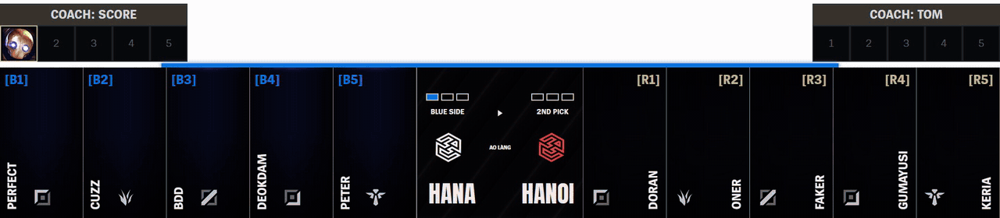

Kết quả khi đã đủ 10 tướng:

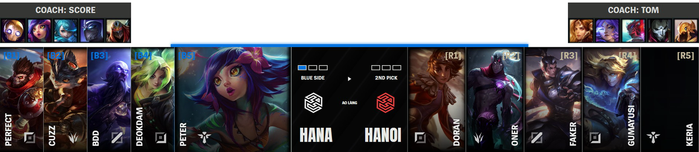

### Trong game

#### Thanh tỉ số

Tỉ số đội, tổng vàng, chênh lệch vàng, số trụ, rồng đã hạ, đồng hồ trận và
dấu các loại rồng của mỗi đội.


#### Timer mục tiêu

Đếm ngược hồi sinh rồng, Baron, Herald hoặc Voidgrub, kèm biểu tượng đúng loại.

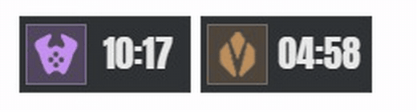

#### Bảng thông tin người chơi

10 hàng: đồ, ô trang bị, rune, phép bổ trợ, chân dung, tên, KDA, CS/vàng, thanh
máu và tài nguyên. Chiêu cuối có vòng hồi, bị phủ đen khi chưa cộng điểm.

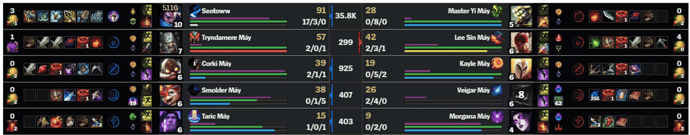

Ba biểu tượng nhỏ riêng cho từng tướng:

| Tướng có stack (Smolder) | Tiền thưởng khi hạ (bounty) |
| --- | --- |
| 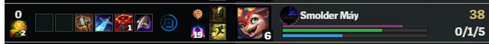 | 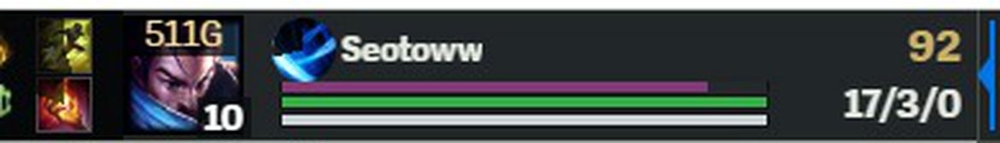 |

Bounty chỉ hiện từ 100G trở lên và chỉ lấy phần nguyên của giá trị game báo.
Stack của các tướng (Smolder, Veigar, Nasus…) nằm cạnh biểu tượng chiêu cuối
khi nguồn dữ liệu có giá trị tương ứng.

#### Các bảng phụ

Bật từ Studio, đặt cùng trục với bảng thông tin.

| Tổng vàng | Kinh nghiệm và cấp |
| --- | --- |
| 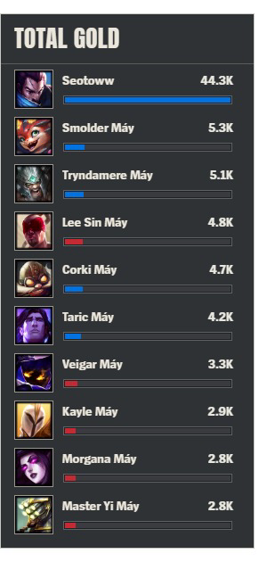 | 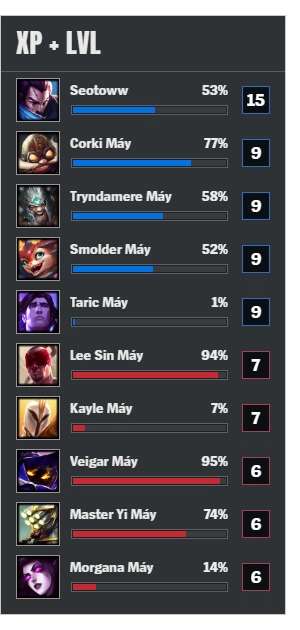 |

Rune toàn đội:

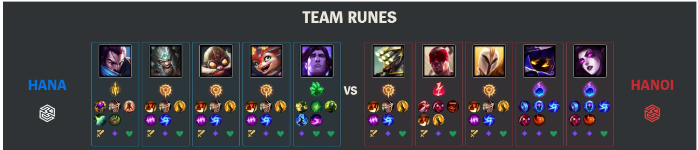

#### Layout tối giản

Chỉ giữ chân dung, cấp, thanh máu/tài nguyên và chiêu cuối. Đồ hoàn thành và
phần thưởng quest hiện ngay trên chân dung.

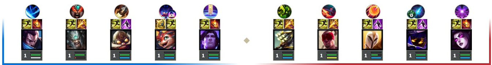

#### Hiệu ứng trên chân dung

Hiệu ứng nổi lên trên chân dung người chơi và tự tắt sau vài giây.

| Lên cấp | Hoàn thành món đồ lớn |
| --- | --- |
| 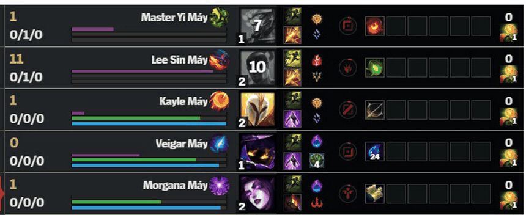 | 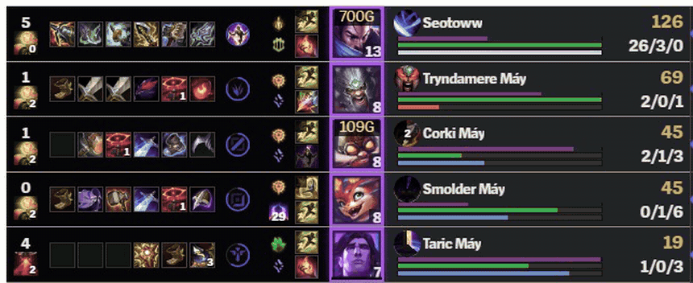 |

#### Hoàn thành lane quest

Mỗi vị trí có bảng quest riêng: tên vị trí, phần thưởng và giới hạn cấp.

| Đường trên | Rừng | Đường giữa |
| --- | --- | --- |
| 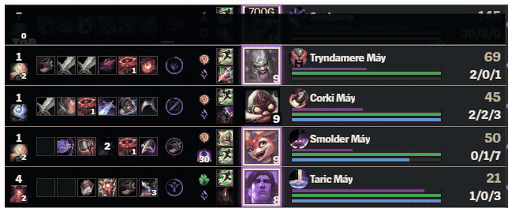 | 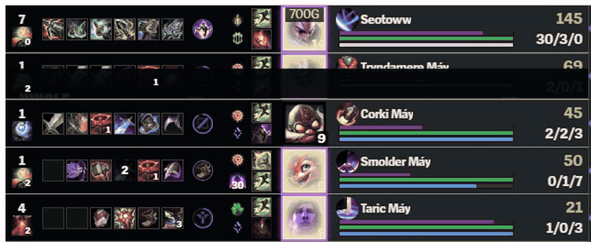 | 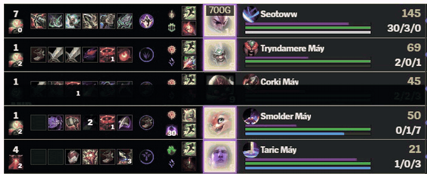 |

| Xạ thủ | Hỗ trợ |
| --- | --- |
| 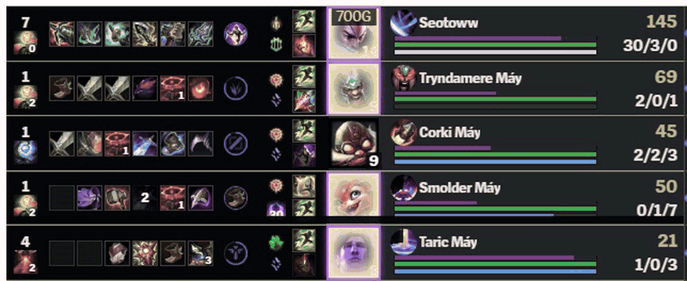 | 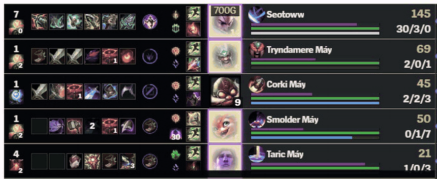 |

#### Mục tiêu lớn

Hạ rồng: biểu ngữ theo loại rồng cùng dải biểu tượng đội vừa hạ.

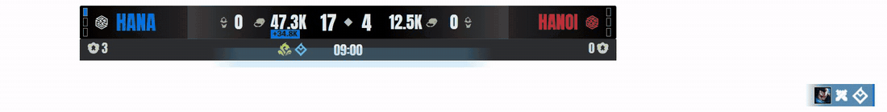

| Rồng lửa | Rồng Ngàn Tuổi |
| --- | --- |
| 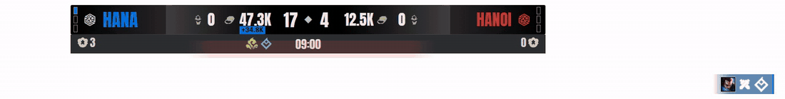 | 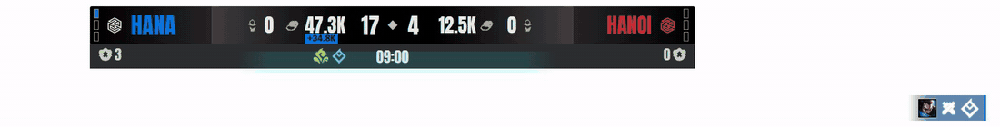 |

Linh hồn rồng (artwork tĩnh theo từng hệ, kèm mô tả hiệu ứng):

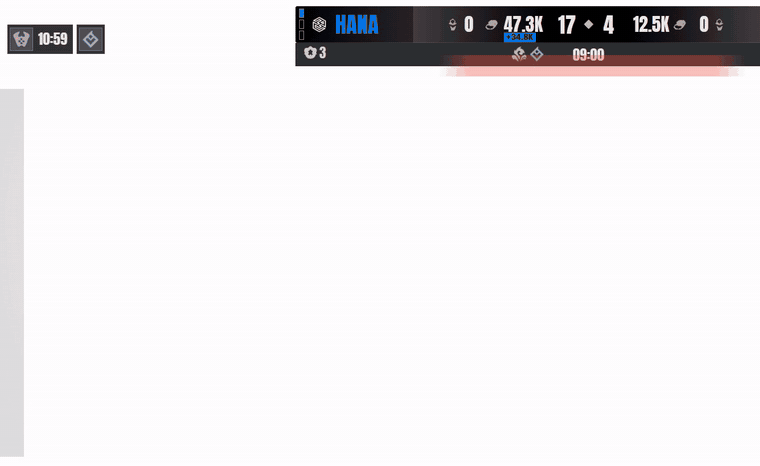

Baron Power Play: chênh lệch vàng khi có bùa, đồng hồ bùa và khung tím quanh
người chơi được bùa. Khi có cả bùa Elder, khung đổi theo.

| Baron Power Play | Bùa Baron và Elder cùng lúc |
| --- | --- |
| 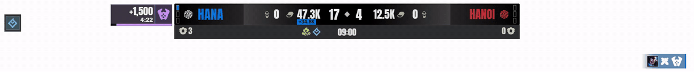 | 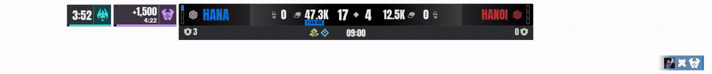 |

Phá trụ đầu tiên và đồng hồ nhà lính:

| Trụ đầu tiên | Hồi sinh nhà lính |
| --- | --- |
| 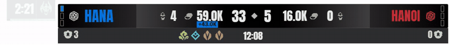 |  |

### Sau trận

Bảng tổng kết: kết quả, thời lượng, KDA, vàng, trụ, rồng, Baron, Herald,
Voidgrub, cấm, sát thương theo vị trí và đường chênh lệch vàng theo thời gian.
Cảnh chờ dữ liệu hiện trước khi có kết quả.

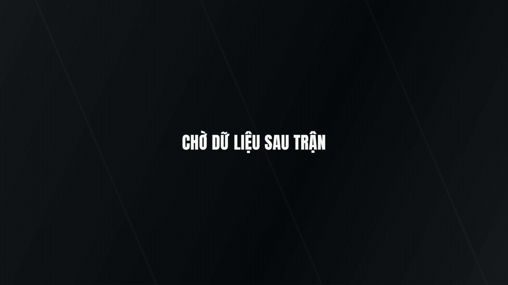

Nguồn thật của postgame là bản replay `.rofl` (xem [Nguồn dữ liệu](#nguồn-dữ-liệu)).

### Nguồn của hình mẫu

Hình được dựng trên máy dev bằng Chrome không giao diện, phát lại bản ghi trận
thật `2026-10-17T02-41-50-859Z` (trận replay, 10 người). Tên đội HANA/HANOI là
cấu hình mẫu. Những phần bản ghi không có sự kiện tương ứng được dựng bằng dữ
liệu mẫu và **không phải dữ liệu thật**:

| Phần tử | Nguồn |
| --- | --- |
| Thanh tỉ số, timer, bảng thông tin, lên cấp, lên đồ | Bản ghi thật, phát lại |
| Bảng vàng, kinh nghiệm, rune, layout tối giản | Bản ghi thật |
| Stack Smolder, bounty | Bản ghi thật |
| Quest xạ thủ, hạ rồng, trụ đầu tiên | Bản ghi thật (sự kiện có trong bản ghi) |
| Rồng lửa, rồng Ngàn Tuổi | Sự kiện hạ rồng thật, đổi loại rồng bằng biến thể xem thử |
| Quest đường trên, rừng, giữa, hỗ trợ | Mẫu: dựng từ quest xạ thủ thật, đổi vị trí |
| Linh hồn rồng, Baron Power Play, Elder | Mẫu: bản ghi chưa có sự kiện, dựng từ sự kiện hạ rồng |
| Đồng hồ nhà lính | Mẫu: biến thể xem thử |
| Cấm chọn | Bộ mẫu UI (`source: "reference"`): hình chỉ minh họa, bản chạy thật nhận từ LCU |
| Sau trận | Bộ mẫu `samplePostgame()` |

Chưa có mẫu thật cho: damage theo giao tranh, linh hồn rồng, Baron, quest các
vị trí khác ngoài xạ thủ. Xem [PROJECT_STATUS.md](PROJECT_STATUS.md).

## Chạy nhanh

Cài Node.js 24, mở terminal tại thư mục project:

```powershell
npm ci
npm run build
npm start
```

- Studio: http://127.0.0.1:4310/?page=studio
- Cấu hình trận: http://127.0.0.1:4310/?page=theme
- OBS: http://127.0.0.1:4310/overlay, kích thước 1920 × 1080.
- Dừng bằng Ctrl+C. Sau khi cập nhật source, build lại rồi khởi động lại backend.

Backend chỉ lắng nghe trên máy local. Không mở port ra LAN hoặc Internet.
Không dùng `npm ci --omit=dev`: backend hiện chạy bằng `tsx`.

## Valorant

Module Valorant dùng Spectra Client chính thức chạy ngầm, backend fork và overlay
VAL26. Setup host và player, cách mở tunnel, nhận code 5 ký tự, kết nối auxiliary
và camera được hướng dẫn tại
[Hướng dẫn setup Valorant](collector/hosts/valorant-collector/README.vi.md).

## Trước khi phát

1. Vào **Cấu hình trận đấu** để đặt tên đội, màu, logo, tỉ số và layout.
   Logo không bắt buộc. Lưu cấu hình để cập nhật Studio và OBS.
2. Vào **Nguồn dữ liệu** để chọn nguồn trận. Tắt dữ liệu mẫu khi phát thật.
3. Mở **Cấm chọn** để nhập huấn luyện viên, cấm theo series và đổi bên. Pick/ban
   tự chạy theo LoL Client khi vào phòng chọn tướng; cần client đang mở.
4. Dùng **Phát sóng** để bật leaderboard, rune, timer nhà lính và layout tối giản.
5. **Phòng thử** dùng bản ghi đã lưu, có play/pause, tua và tốc độ.
   Khi phát bản ghi, đầu ra OBS cũng dùng bản ghi đó.

Các scene OBS cố định: `/overlay?scene=ingame`, `/overlay?scene=draft`,
`/overlay?scene=postgame`. Renderer không chứa ảnh đối chiếu, nút điều khiển
hoặc nhãn kiểm thử. Trạng thái nguồn và cảnh báo nằm trong Studio.

## Nguồn dữ liệu

| Nguồn | Điều kiện |
| --- | --- |
| LeagueBroadcast | LB chạy riêng và đang xuất feed spectator |
| Collector tích hợp | Cần runtime, DLL và cache local được chuẩn bị riêng |
| Riot local | Chỉ có các field mà API local cung cấp |
| LCU champ-select | Cấm chọn: LoL Client đang mở, đọc cục bộ, chỉ đọc |
| Bản ghi | Cần thư mục capture trên máy; không đi kèm Git |

Chạy collector tích hợp bằng `npm run start:collector` hoặc
`npm run start:collector:no-auth` sau khi chuẩn bị runtime.
Clone repository không tự có DLL, runtime hoặc tài khoản collector.
Xem [hướng dẫn collector](collector/docs/PROJECT-RUNBOOK.vi.md).

Ghi trận với collector không tài khoản bằng terminal thứ hai:

```powershell
npm run capture:collector -- 10800000
```

Dừng ghi ở terminal khác:

```powershell
npm run capture:collector:stop
```

Bản ghi nằm trong `data/captures`, nhịp mục tiêu 0,5 giây. Giữ nguyên bản gốc.
[Hướng dẫn trận thật](docs/LIVE_MATCH_RUNBOOK.md) có quy trình kiểm tra chi tiết.

## Phần chưa hoàn tất

- Chưa có nguồn postgame tự động đáng tin cậy cho custom trên máy spectator.
  LCU đọc được trận khi đăng nhập người tham gia, nhưng cùng trận trả 404 khi
  đổi sang spectator. File replay thử nghiệm do tài khoản người chơi tải;
  hướng đọc metadata đang tạm hoãn.
- Postgame đi theo replay `.rofl` (tự theo dõi thư mục Replays, kèm sổ trận từ
  collector). Riot API và LCU EOG đã gỡ khỏi project.
- Damage theo giao tranh, một số stack champion và telemetry khác còn thiếu mẫu.
- Ẩn riêng dấu 18+ VNG trong game đang để nghiên cứu. Valorant và REA giữ riêng.

## Kiểm tra và tài liệu

```powershell
npm test
npm run build
npm run test:integration
npm run test:collector
npm run test:collector-capture
npm run test:collector-validation
```

Integration dùng backend/theme test riêng; không chạy script đổi mock trên
phiên đang phát sóng. Hướng dẫn chi tiết:

- [Mục lục tài liệu](docs/README.md)
- [Cài đặt và chuyển máy](docs/SETUP_VI.md)
- [Trạng thái bàn giao](PROJECT_STATUS.md)
- [Kết quả kiểm thử](docs/TEST_REPORT.md)
- [Kiến trúc](docs/ARCHITECTURE.md)
- [Lộ trình](docs/ROADMAP.md)
- [Hướng dẫn Studio](docs/STUDIO_UI.md)

Theme cá nhân, captures và credentials không theo Git. Không gửi API key hoặc
LCU credentials vào chat. Asset Riot và nhận diện giải cần được kiểm tra quyền
sử dụng trước khi phân phối ngoài nội bộ.
